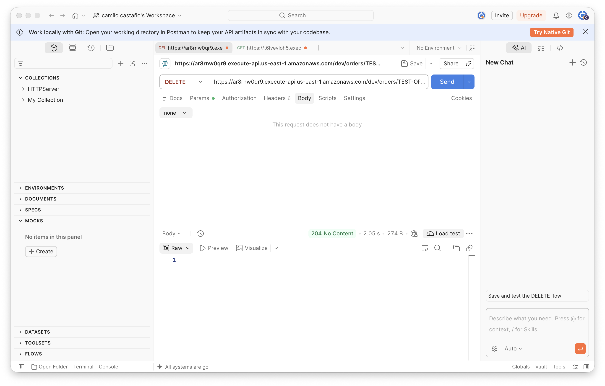
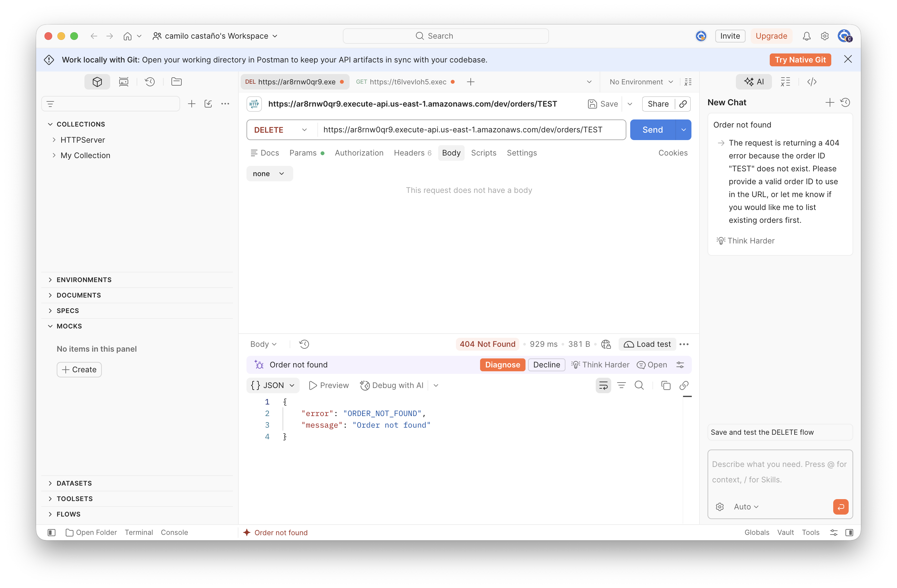

## Final Challenge: Extend the API

The API initially supported three operations: create, retrieve by ID, and search by customer. The final challenge adds a fourth:

```text
DELETE /orders/{id}
```

A successful deletion returns `204 No Content` with an empty body. Deleting a nonexistent order returns `404 ORDER_NOT_FOUND`, and a null or blank identifier returns `400 BLANK_NULL`. These are the same error responses used by the existing retrieval operations.

### Design questions

**1. Which Java classes should change?**

`OrderService` needs a new `deleteOrder(String id)` method that removes an order from the in-memory list. The `http` package needs a new `DeleteOrderHandler` class to receive the proxy event and delegate to `OrderService`. `HttpResponse` needs a new factory method for the `204 No Content` response, since no existing method produces a bodyless response with that status code.

**2. Do you need a new Lambda function?**

Yes. Each handler method is deployed as a separate Lambda function, so the delete operation requires its own function configured with the handler `eci.arem.http.DeleteOrderHandler::handle`.

**3. Does API Gateway configuration need to change?**

Yes. A `DELETE` method must be added to the existing `/orders/{id}` resource in the proxy API, pointing to the new Lambda function with Lambda proxy integration enabled. No mapping templates or integration responses are needed, as the handler builds the complete HTTP response.

**4. Where should the deletion logic reside?**

In `OrderService`. The service layer owns the in-memory order list, so it is the natural place for the `remove` operation. The handler extracts the identifier from the proxy event and delegates to `OrderService.deleteOrder(id)`.

**5. Where should the decision to return 204 or 404 reside?**

The decision is split between `OrderService` and `HttpResponse`. `OrderService.deleteOrder` reuses `getOrderById` internally: if the order does not exist, `getOrderById` throws `OrderException` with `ORDER_NOT_FOUND`, and the handler catches it and calls `HttpResponse.fromException` to produce the `404` response. If the order exists and is removed, the handler calls `HttpResponse.noContent()` to produce the `204` response. The status-code logic lives in `HttpResponse`; the existence check lives in `OrderService`.

**6. Which tests should be added?**

Unit tests for the new `deleteOrder` method in `OrderService`:
- Deleting an existing order removes it from the list (verified by a subsequent `getOrderById` throwing `ORDER_NOT_FOUND`).
- Deleting a nonexistent order throws `ORDER_NOT_FOUND`.
- Deleting with a `null` identifier throws `BLANK_NULL`.
- Deleting with a blank identifier throws `BLANK_NULL`.
- Deleting one order does not affect other orders belonging to the same customer.

### Implementation

#### OrderService.deleteOrder

The new method reuses `getOrderById` to validate the identifier and locate the order. If the order exists, it is removed from the list. If not, `getOrderById` throws the appropriate `OrderException` before the removal is attempted:

```java
public static void deleteOrder(String id) {
    Order order = getOrderById(id);
    orders.remove(order);
}
```

This design avoids duplicating the null-check and not-found logic already present in `getOrderById`. The method returns `void` because a successful deletion has no meaningful return value.

#### HttpResponse.noContent

A new factory method produces the `204 No Content` response envelope. Unlike the other factory methods, it sets an empty body and no `Content-Type` header, since a `204` response should not include a representation:

```java
public static Map<String, Object> noContent() {
    Map<String, Object> response = new HashMap<>();
    response.put("statusCode", 204);
    response.put("headers", Map.of());
    response.put("body", "");
    return response;
}
```

`HttpResponse` now provides five factory methods, one for each HTTP response pattern used by the API:

| Factory method | Status code | Use case |
|---|---|---|
| `ok(int, Object)` | Any (typically `200`) | Successful retrieval or query |
| `created(Object, String)` | `201` | Successful creation with `Location` header |
| `noContent()` | `204` | Successful deletion |
| `fromException(OrderException)` | Depends on error code | Known application error (`400`, `404`) |
| `internalError(String)` | `500` | Unexpected failure |

#### DeleteOrderHandler

The handler follows the same pattern as the other proxy handlers: extract the path parameter, delegate to `OrderService`, catch `OrderException`, and return the appropriate `HttpResponse`:

```java
public class DeleteOrderHandler {
    public static Map<String, Object> handle(Map<String, Object> event) {
        try {
            Map<String, String> pathParameters =
                    (Map<String, String>) event.get("pathParameters");
            String id = pathParameters != null ? pathParameters.get("id") : null;

            OrderService.deleteOrder(id);
            return HttpResponse.noContent();

        } catch (OrderException ex) {
            return HttpResponse.fromException(ex);
        } catch (Exception ex) {
            return HttpResponse.internalError(ex.getMessage());
        }
    }
}
```

The handler is configured as a Lambda function with the handler string `eci.arem.http.DeleteOrderHandler::handle`.

#### Updated project structure

```text
orders-api/
├── pom.xml
└── src/
    ├── main/
    │   └── java/eci/arem/
    │       ├── Order.java
    │       ├── OrderService.java
    │       ├── dto/
    │       │   ├── CreateOrder.java
    │       │   └── OrderMapper.java
    │       ├── exception/
    │       │   ├── HttpStatusCode.java
    │       │   ├── OrderErrorCode.java
    │       │   └── OrderException.java
    │       └── http/
    │           ├── CreateOrderHandler.java
    │           ├── DebugHandler.java
    │           ├── DeleteOrderHandler.java
    │           ├── GetOrderByIdHandler.java
    │           ├── GetOrdersByCustomerIdHandler.java
    │           └── HttpResponse.java
    └── test/
        └── java/eci/arem/
            └── OrderServiceTest.java
```

#### Updated handler table

The complete set of Lambda functions for the proxy API:

| Operation | HTTP method | Resource | Lambda handler |
|---|---|---|---|
| Create an order | `POST` | `/orders` | `eci.arem.http.CreateOrderHandler::handle` |
| Retrieve by ID | `GET` | `/orders/{id}` | `eci.arem.http.GetOrderByIdHandler::handle` |
| Search by customer | `GET` | `/orders` | `eci.arem.http.GetOrdersByCustomerIdHandler::handle` |
| Delete an order | `DELETE` | `/orders/{id}` | `eci.arem.http.DeleteOrderHandler::handle` |

### API Gateway configuration

A `DELETE` method was added to the `/orders/{id}` resource with Lambda proxy integration enabled, pointing to the new Lambda function:


### Complete HTTP response summary

The final API uses every status code required by the challenge:

| Request outcome | HTTP response | Body or behavior |
|---|---:|---|
| Create an order successfully | `201 Created` | The created `Order` with `Location` header |
| Retrieve an existing order | `200 OK` | One `Order` object |
| Search for a customer with orders | `200 OK` | A JSON array of matching orders |
| Search with no matching orders | `200 OK` | An empty JSON array |
| Delete an existing order | `204 No Content` | Empty body |
| Retrieve or delete a missing order | `404 Not Found` | `ORDER_NOT_FOUND` with `Order not found` |
| Missing or blank identifier/customerId | `400 Bad Request` | `BLANK_NULL` with `Value cannot be null or blank` |
| Negative quantity on create | `400 Bad Request` | `NEGATIVE_QUANTITY` with `Quantity must be greater than 0` |
| Unexpected failure | `500 Internal Server Error` | `INTERNAL_ERROR` with the exception message |

### Deploy and test the delete operation

The API was deployed to the `dev` stage at:

```text
https://ar8rnw0qr9.execute-api.us-east-1.amazonaws.com/dev
```

```bash
export API_BASE_URL="https://ar8rnw0qr9.execute-api.us-east-1.amazonaws.com/dev"
```

Delete the seeded test order:

```bash
curl -i -X DELETE "$API_BASE_URL/orders/TEST-ORDER-001"
```

A successful deletion returns `204 No Content` with no response body:



Attempt to delete a nonexistent order:

```bash
curl -i -X DELETE "$API_BASE_URL/orders/DOES-NOT-EXIST"
```

The response is `404 ORDER_NOT_FOUND`:



### Unit tests for delete

The `OrderServiceTest` class includes a new `DeleteOrderOp` nested test class with five tests:

| Test | Assertion |
|---|---|
| `deleteOrderShouldRemoveExistingOrder` | After deletion, `getOrderById` throws `ORDER_NOT_FOUND` for the deleted ID |
| `deleteOrderShouldThrowWhenIdDoesNotExist` | Throws `OrderException` with `ORDER_NOT_FOUND` for an unknown ID |
| `deleteOrderShouldThrowWhenIdIsNull` | Throws `OrderException` with `BLANK_NULL` for a `null` ID |
| `deleteOrderShouldThrowWhenIdIsBlank` | Throws `OrderException` with `BLANK_NULL` for a blank ID |
| `deleteOrderShouldNotAffectOtherOrders` | Other orders from the same customer remain after one is deleted |

These tests follow the same structure as the existing retrieval tests: they create orders with unique customer IDs (using `System.nanoTime()` to avoid collisions with other test methods), perform the operation, and assert the expected outcome or exception.

## Required Architecture Diagram

The following diagram shows the final architecture of the proxy integration API. It identifies the five layers and the direction of communication, and marks which components depend on AWS and which are ordinary Java.

<!-- Replace this line with the exported diagram image once generated -->


The diagram shows the request flowing from the client through API Gateway, into the Lambda runtime, through the HTTP adapter layer (the `http` package), and into the application logic (`OrderService`). The response follows the reverse path: `OrderService` returns a domain object or throws an exception, the handler builds the response envelope using `HttpResponse`, Lambda serializes it, and API Gateway forwards the status code, headers, and body to the client. The boundary between AWS-managed components (API Gateway and the Lambda runtime) and ordinary Java code (the `http` handlers and `OrderService`) is drawn at the Lambda function entry point.

## Run the Tests and Package the Final Application

After adding the delete operation, rebuild and test the project:

```bash
mvn clean test
```

The test suite now includes four nested test classes:

| Test class | Tests | Scope |
|---|---|---|
| `DataCleaning` | 7 | Input validation and trimming in `CreateOrder` |
| `CreateOrderOp` | 4 | Order creation, persistence, and ID uniqueness |
| `RetrieveOrders` | 10 | Lookup by ID and customer, not-found and blank-ID handling |
| `DeleteOrderOp` | 5 | Deletion, not-found, blank-ID, and isolation from other orders |

Total: **26 unit tests**.

Package the application for deployment:

```bash
mvn clean package
```

Upload the resulting `target/orders-api-1.0-SNAPSHOT.jar` to each Lambda function. The `maven-shade-plugin` bundles Jackson into the JAR, so no additional runtime dependencies need to be configured in Lambda.

## References

[1] [AWS Lambda: Define a Lambda function handler in Java](https://docs.aws.amazon.com/lambda/latest/dg/java-handler.html)

[2] [AWS API Gateway: Set up Lambda custom integrations](https://docs.aws.amazon.com/apigateway/latest/developerguide/set-up-lambda-custom-integrations.html)

[3] [AWS API Gateway: Mapping template transformations](https://docs.aws.amazon.com/apigateway/latest/developerguide/models-mappings.html)

[4] [AWS API Gateway: Handle Lambda errors in API Gateway](https://docs.aws.amazon.com/apigateway/latest/developerguide/handle-errors-in-lambda-integration.html)

[5] [AWS API Gateway: Lambda proxy integrations](https://docs.aws.amazon.com/apigateway/latest/developerguide/set-up-lambda-proxy-integrations.html)
