## Design the API

Para la arquitectura de la API se plantean 3 formatos JSON

Solicitud de crear una orden (Request)

```json
{
  "customerId": "CUST-42",
  "product": "MacBook Air",
  "quantity": 1
}
```

Orden (Response)

```json
{
  "id": "ORD-001",
  "customerId": "CUST-42",
  "product": "MacBook Air",
  "quantity": 1
}
```

> La diferencia entre la solicitud y respuesta de la creación de una orden es, el ID puesto que, este es autogenerado 
> por el servidor en lugar de que el cliente sea quien se lo pase

Error

```json
{
  "error": "ORDER_NOT_FOUND",
  "message": "Order ORD-999 does not exist"
}
```

La arquitera por metodo es 

Create an order

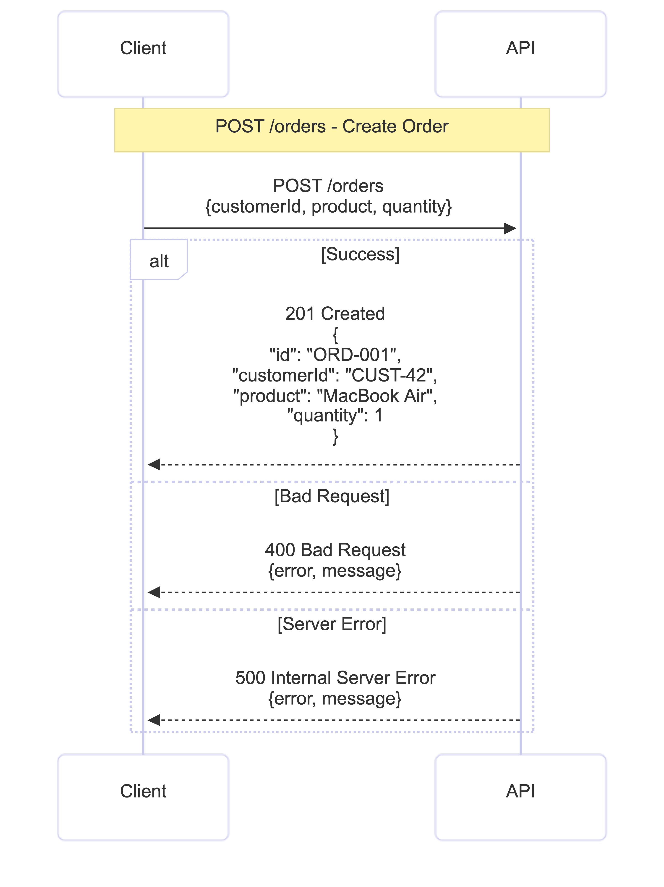

Retrieve an order

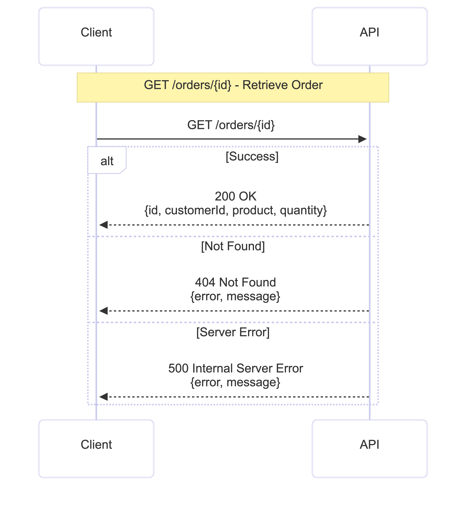

Find orders belonging to a customer

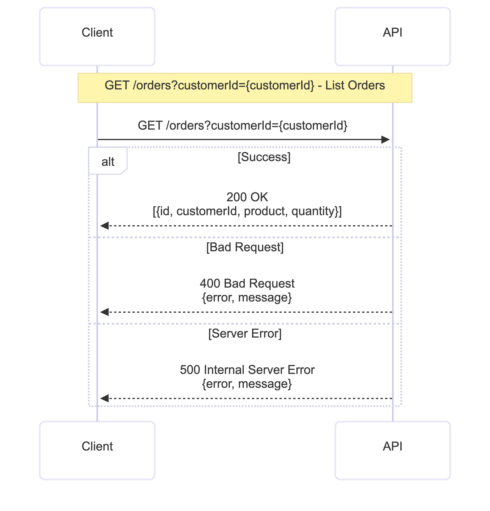

### Questions

1. What are the resources in your API?
    
2. Why did you choose /orders/{id} to retrieve a particular order?

    In API REST conventions, is normal to use path parameters ([PATH]/[PARAMETHER]) para recibir un "recurso exacto"
3. Why is customerId represented as a query parameter in the search operation?

    los query parameter son mas utilizados para filtrar información y devolver todos los recursos que cumplen con el filtro
4. What should POST /orders return when an order is successfully created?
Para mi caso en particular, devuelve tanto la orden creada como HTTP 201 Created
5. What should the API return when an order does not exist?
6. What information should an error response contain?

## Implement the App in plain Java
describir la arquitecutra de la aplicacion

## Test the application locally
```bash
mvn clean test
```
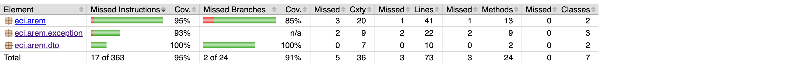

### Checkpoint

1. Can the application functionality be tested without AWS?
2. Does your application require a web server?
3. Does it require Spring Boot?
4. What does the generated JAR contain?
5. Which parts of your application currently know about HTTP?

## Deploy the Java Function to AWS lambda

Luego de empaquetar la aplicacion en un JAR con

```bash
mvn clean package
```
Creamos 3 lambda functions, una para crear una orden, otra para buscar una orden de acuerdo a su ID y otra para 
buscar las ordenes de un cliente. La creación de la lambda sigue el mismo patrón

primero le asignamos un nombre y runtime a la función, además de asignarle el rol **LabRole**


Subimos el JAR generado en el paso anterior


Editamos la función para que apunte a la clase y metodo de nuestra aplicacion que deseaomos correr
   
siguiendo el patrón de lambda

```text
[paquete].[clase]::[metodo]
```


We test the function with a json payload

```json
{
  "customerId": "CUST-42",
  "product": "MacBook Air",
  "quantity": 1
}
```

Hacemos la prueba y vemos que en efecto devuelve los valores inresados + el ID generado


We repet the process for the other functions

Get orders by ID

En este caso debido a que los IDs son generados de forma aleatoria por la app, y cada función es independiente de la otra,
es decir cada una arranca aparte, generando IDs diferentes, se va a tener que crear una orden semilla
con un ID fijo para poder realizar las pruebas.

```java
new Order("TEST-ORDER-001", "CUST-TEST", "Producto de prueba", 1);
```
So, now we invoke the function with the ID of the order we just created


Finally, we test the getOrdersByCustomer function

Al mandarle "CUST-04" obtenemos el siguiente resultado

```json
[
   {
      "id": "ef3f23b5-9317-4a83-92bf-fce17b099165",
      "customerId": "CUST-04",
      "product": "Impresora",
      "quantity": 5
   },
   {
      "id": "62dcc5de-36f7-4c75-8bfa-d4f5c992f25a",
      "customerId": "CUST-04",
      "product": "Monitor",
      "quantity": 7
   },
   {
      "id": "8c879e9a-e25d-4dbf-9811-07c3667d8bd3",
      "customerId": "CUST-04",
      "product": "Laptop",
      "quantity": 7
   },
   {
      "id": "ae5dab79-ad04-451a-a244-992ca4643612",
      "customerId": "CUST-04",
      "product": "Teclado",
      "quantity": 8
   }
]
```

## API Gateway Mapping

Luego de crear nuestra API REST


Vamos a great nuesto primer recurso /orders/{id} con el metodo GET que apunte a la funcion lambda que obtiene una orden por su ID

> /{id} le indica a la api que se trata de una variable de path, podermos verificarlo en el method request


En integration request creamos el template mapping


Probamos el metodo y vemos que funciona correctamente


Repetimos el proceso para obtener las ordenes de un cliente y crear una orden pero esta vez sin commillas

Para el crear orden, es muy diferente porque no necesita de query ni de path variable ni de template. Por ende, solo se testea mandando 
la solicitud con el body que ya hemos creado


Ahora para obtener customer orders usamor query parameters

El query parameter lo definimos en el method request


Y creamos el template mapping igual que hicmos ante


Hacemos la prueba y vemos que funciona correctamente


## HTTP semantics

A working JSON response is not sufficient to constitute a well-designed REST API.

Your API must distinguish different outcomes using HTTP.

Implement appropriate responses for at least

### Get order by ID

Nos dirijimos a **Method Response** y agregamos una respuesta 404

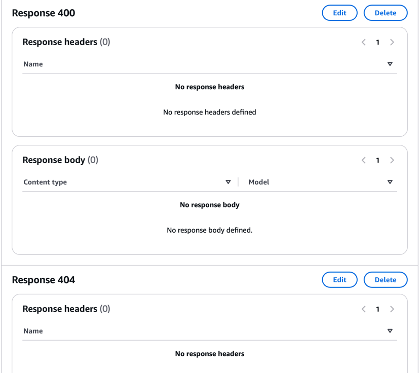

 Una vez creada la respuesta, vamos a **Integration Response** y agregamos la siguiente plantilla


404

```json
{
   "error": "ORDER_NOT_FOUND",
   "message": "$input.path('$.errorMessage')"
}
```


> 200 es el codigo de respuesta por defecto y devuelve el body de la respuesta (Order)

### Get orders by customer ID

En este escenario ponemos solo la plantilla 

400
```json
{
   "error": "BLANK_NULL",
   "message": "$input.path('$.errorMessage')"
}
```


200 devuelve un array de ordenes

### Create order

201 devuelve el body de la respuesta (Order)

se crea un 400 generico porque:

Por qué addOrder/CreateOrder siempre cae en el 400 genérico

Este es el detalle que te expliqué antes y que vale la pena tener claro (útil también para tu Checkpoint 3): la validación de CreateOrder vive en su constructor compacto, y Jackson ejecuta ese constructor durante la deserialización del body — antes de que tu método addOrder siquiera corra. Cuando ese constructor lanza OrderException, Lambda lo captura en esa etapa temprana y lo reemplaza con el mensaje genérico "An error occurred during JSON parsing", perdiendo el mensaje específico ("Quantity must be greater than 0", etc.).

Por eso para POST /orders usamos un catch-all (.*) en vez de patrones específicos como en GET /orders/{id}: no hay forma de distinguir cuál validación falló desde el lado de API Gateway, porque esa información nunca llega al JSON de error. Es una limitación real de combinar validación-en-constructor con deserialización automática de Lambda — no un error tuyo, solo algo a documentar si tu entrega pide reflexionar sobre las responsabilidades y límites de API Gateway.

```json
{
  "error": "INVALID_INPUT",
  "message": "The request body is invalid. Check customerId, product and quantity."
}
```

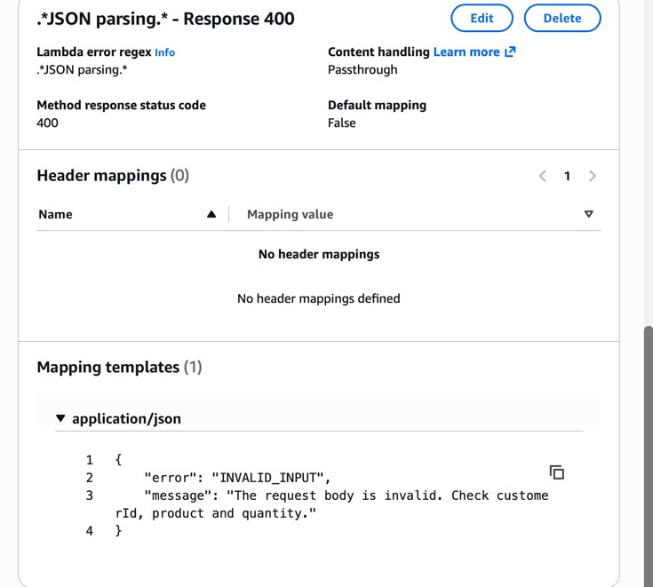
Deplegamos la aplicacion en AWS y empezamos pruebas

### Pruebas

#### Create Order

```text
https://t6lvevloh5.execute-api.us-east-1.amazonaws.com/beta/orders
```
```json
{
  "customerId": "CUST-42",
  "product": "MacBook Air",
  "quantity": 1
}
```
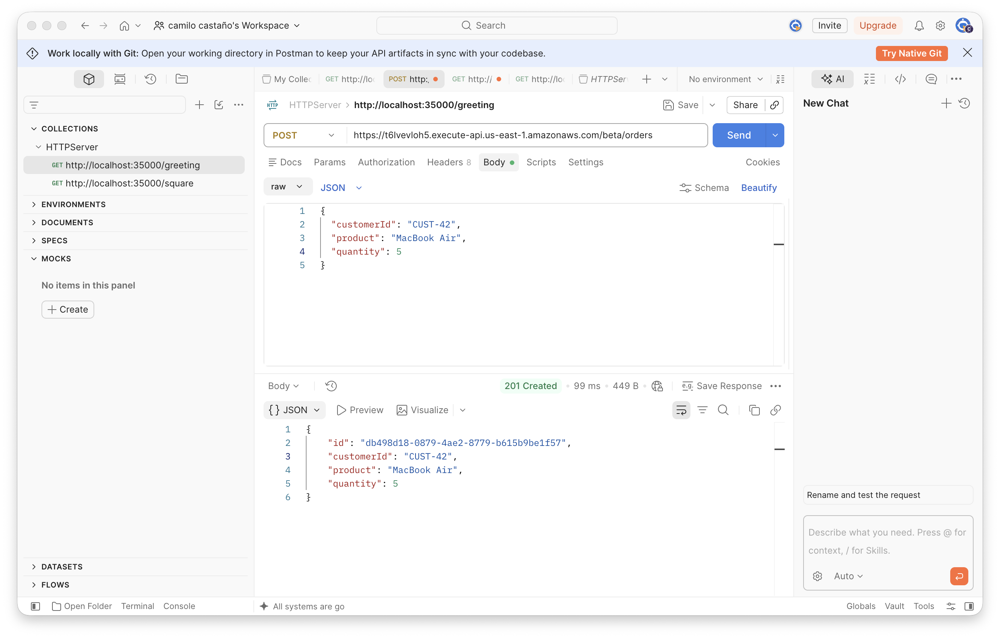

```json
{
  "customerId": "CUST-42",
  "quantity": 1
}
```
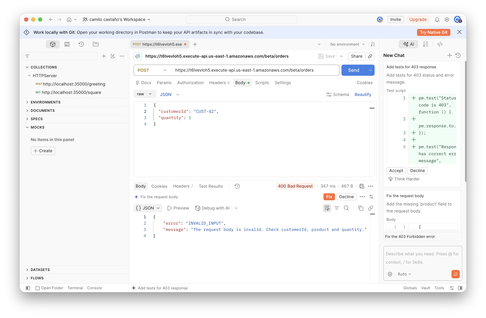

```json
{
  "customerId": "",
  "product": "MacBook Air",
  "quantity": 1
}
```
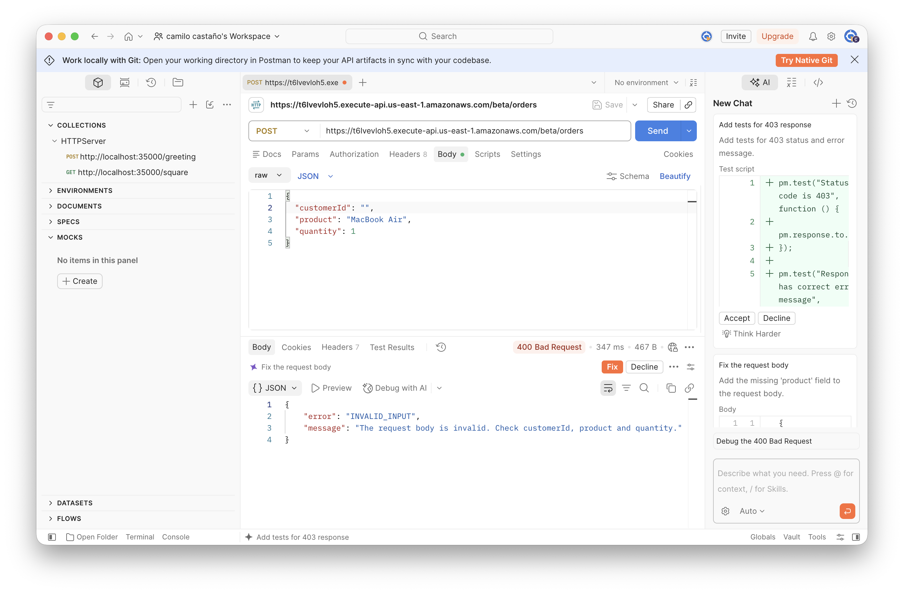

```json
{
  "customerId": "CUST-42",
  "product": "MacBook Air",
  "quantity": -5
}
```

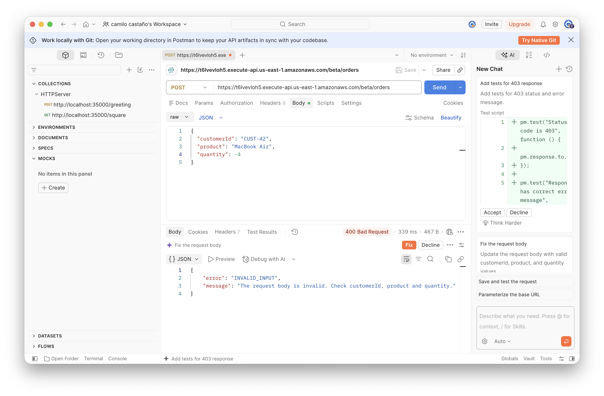

#### Get Order by ID

```text
https://t6lvevloh5.execute-api.us-east-1.amazonaws.com/beta/orders/TEST-ORDER-001
```

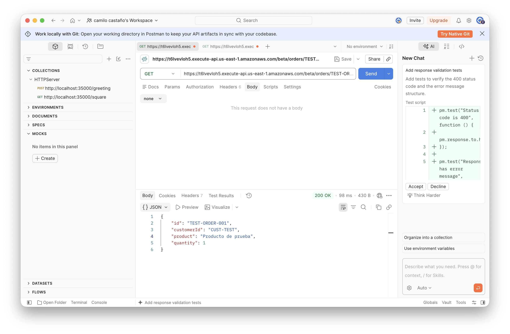

not found
```text
https://t6lvevloh5.execute-api.us-east-1.amazonaws.com/beta/orders/test
```
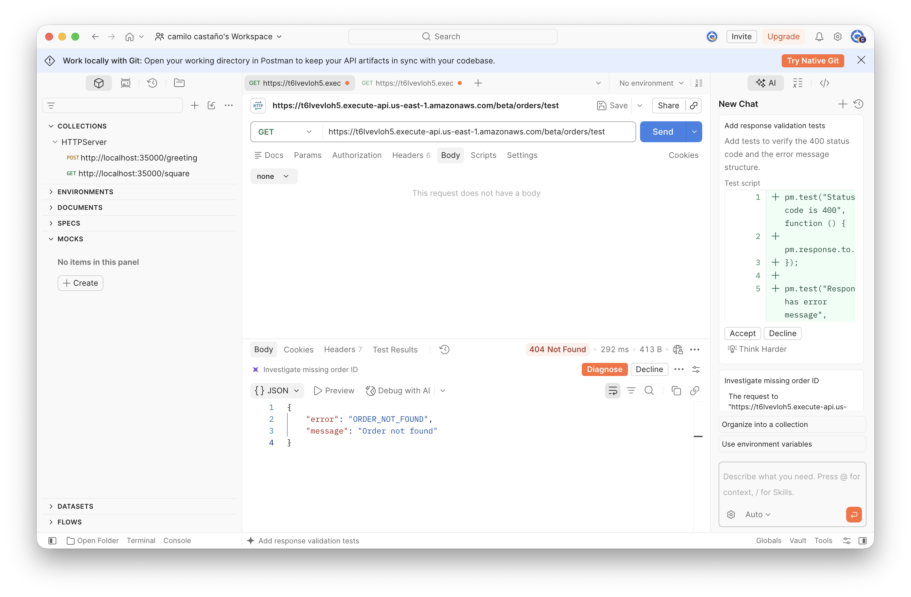

### Get Orders by Customer ID

```text
https://t6lvevloh5.execute-api.us-east-1.amazonaws.com/beta/orders
```

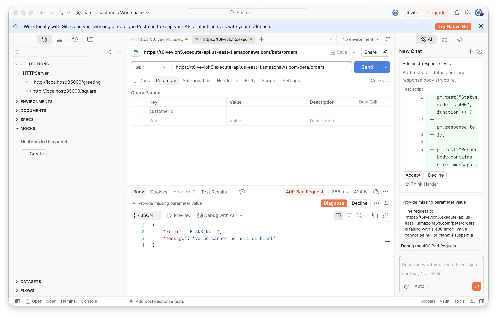

```text
https://t6lvevloh5.execute-api.us-east-1.amazonaws.com/beta/orders?customerId
```

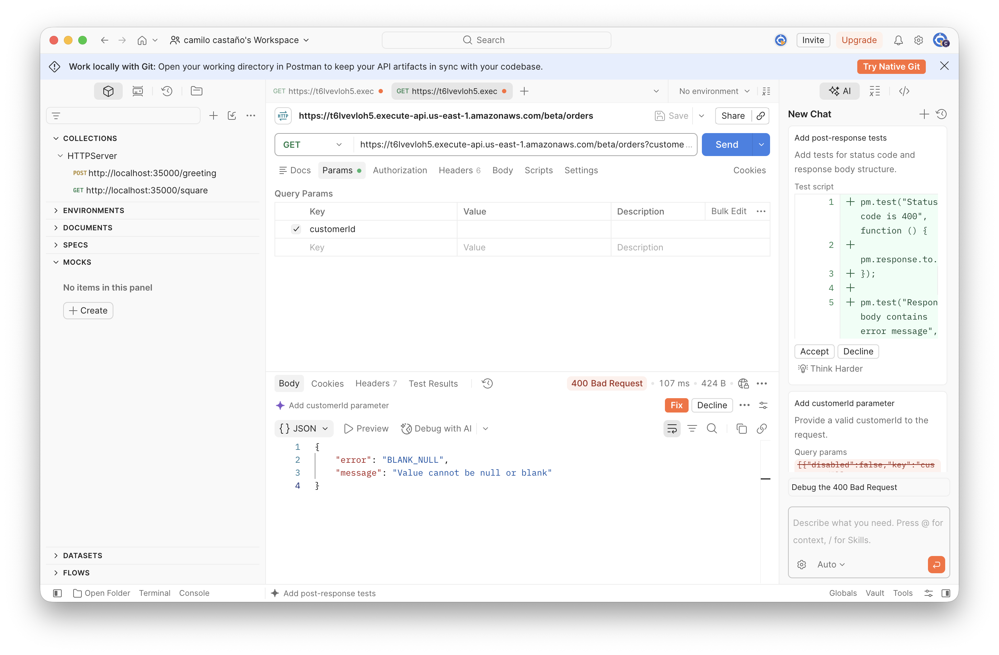

Success

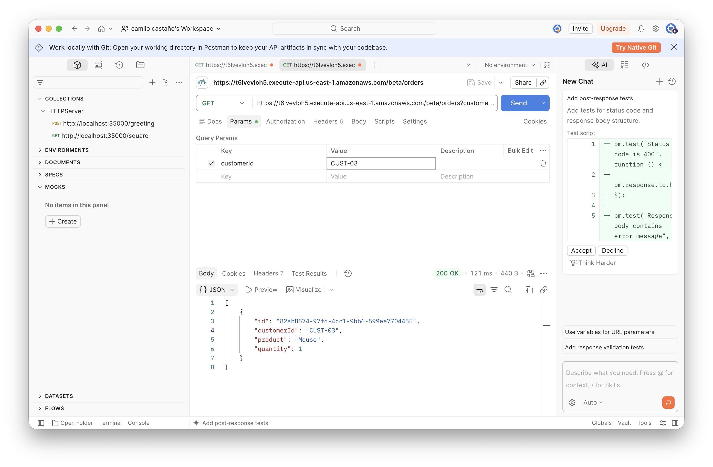